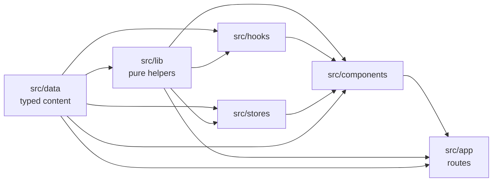
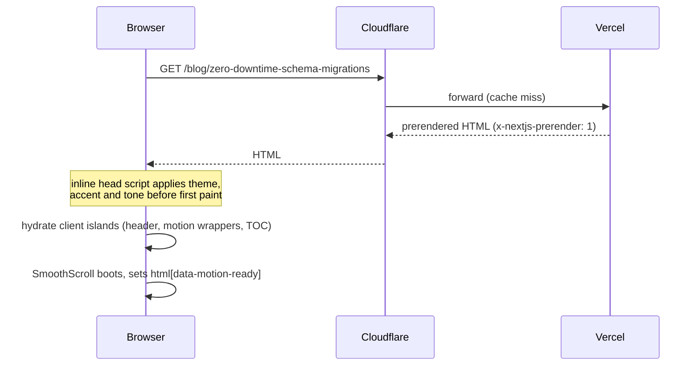

# Architecture

The site is a static-first content site. Content is typed data, every page is prerendered, and
the browser only runs JavaScript for motion, browser state and interactive controls. This guide
covers the shape of the code and the rules that keep it that way.

## Principles

1. **Static first.** Nothing is computed per request. Anything that varies by visitor (theme, the
   current year, the live clock) is resolved in the browser without a hydration mismatch.
2. **One source, many outputs.** A post is written once in `src/data` and rendered as HTML,
   Markdown, RSS, `llms.txt`, JSON-LD and an Open Graph card.
3. **Server by default, client at the leaves.** Server Components render the markup. Client code
   is limited to the pieces that animate, hold state or handle events.
4. **Works without motion.** Every page is readable and usable with JavaScript off or with reduced
   motion. Animation is a layer on top, never a requirement.
5. **Rules live in tooling.** Import direction, link targets, metadata limits and script weight are
   checked by the compiler, ESLint and Playwright rather than by review.

## Layers



Imports only flow left to right. ESLint (`no-restricted-imports` in `eslint.config.mjs`) rejects
the reverse:

| Layer            | May import                          | Must not import                               |
| ---------------- | ----------------------------------- | --------------------------------------------- |
| `src/data`       | `src/data`                          | `lib`, `hooks`, `stores`, `components`, `app` |
| `src/lib`        | `src/data`, `src/lib`, `src/stores` | `components`, `app`                           |
| `src/hooks`      | `src/data`, `src/lib`               | `components`, `app`                           |
| `src/stores`     | `src/data`, `src/lib`               | `components`, `app`                           |
| `src/components` | everything above                    | `app`                                         |
| `src/app`        | everything                          | —                                             |

`import/no-cycle` also blocks circular imports inside a layer.

## Directory map

```text
src/
├── app/                     Routes (App Router)
│   ├── layout.tsx           Root layout: fonts, metadata defaults, pre-paint appearance script
│   ├── page.tsx             Home: Hero, Approach, Work, Experience, Skills, Contact
│   ├── blog/                /blog and /blog/[slug] (+ index.md and opengraph-image)
│   ├── case-studies/        /case-studies and /case-studies/[slug] (+ index.md, opengraph-image)
│   ├── privacy/             /privacy
│   ├── (feeds)/             /rss.xml, /llms.txt, /llms-full.txt, /index.md
│   ├── sitemap.ts, robots.ts, not-found.tsx
│   ├── globals.css          The design system (tokens, variants, utilities)
│   └── fonts/               Self-hosted Clash Display and Satoshi
├── components/
│   ├── layout/              Page chrome: Header, Footer, MobileMenu, Preloader, PageShell
│   ├── sections/            Home page sections and their private pieces
│   ├── motion/              Reusable animation: RevealText, RollText, Marquee
│   ├── scroll/              SmoothScroll, ScrollLink, HorizontalSection
│   ├── article/             Body, contents, share and diagram parts shared by posts and studies
│   ├── blog/, caseStudies/  Cards, covers, diagrams and art for each content type
│   ├── appearance/          Theme, accent and tone controls
│   ├── seo/                 JsonLd and the Open Graph card
│   └── ui/                  Primitives: Button, TextLink, Logo, Seal, icons
├── data/                    Site copy, projects, experience, skills, posts, case studies
├── lib/                     Helpers: gsap setup, metadata, paths, feeds, JSON-LD, appearance
├── hooks/                   useSyncExternalStore-based browser hooks
└── stores/                  zustand stores: appearance, intro, scroll, logo
e2e/                         Playwright: http, document and ui projects
docs/                        This documentation
```

## Rendering model

`next.config.ts` turns on `cacheComponents`, so routes are prerendered by default. Dynamic routes
list their pages in `generateStaticParams`, and `export const ensureStatic = "navigation"` on the
post and case-study pages makes an unknown slug wait for the full render so it returns a real
`404` status.



What happens on the client, in order:

1. The inline `appearanceScript` in `<head>` reads `localStorage`, sets `.dark`,
   `data-accent` and `data-tone`, and adds `motion-ok` unless the visitor prefers reduced motion.
   See [Client state](./client-state.md).
2. React hydrates the client components only. Server-rendered markup stays as it is.
3. On the home page, the `Preloader` plays once per session, then releases the page through the
   intro store. See [Motion and scroll](./motion-and-scroll.md).
4. `SmoothScroll` starts Locomotive Scroll on GSAP's ticker and sets `html[data-motion-ready]`,
   which the tests use as their hydration signal.

### Navigation between pages

Client-side navigation uses `next/link`. With Cache Components, Next.js keeps a few recently
visited routes mounted but hidden inside React's `<Activity>`, and runs their effect cleanup while
hidden. GSAP contexts created with `useGSAP` revert on hide and rebuild on show, so pinned sections
and split text are recreated when you return to a page.

## The client boundary

A component gets `"use client"` only when it needs state, effects, event handlers, DOM refs for
animation or browser APIs. Sections that animate stay on the server and render their outer element
through a small client wrapper:

```tsx
// sections/Experience.tsx: a Server Component
export function Experience() {
  return (
    <ExperienceMotion id="experience" aria-labelledby="experience-title" className="...">
      {/* server-rendered markup and data */}
    </ExperienceMotion>
  );
}

// sections/experience/ExperienceMotion.tsx: "use client"
export function ExperienceMotion({ children, ...props }: ExperienceMotionProps) {
  const ref = useRef<HTMLElement>(null);
  useGSAP(
    () => {
      /* targets found through data-* attributes */
    },
    { scope: ref },
  );
  return (
    <section ref={ref} {...props}>
      {children}
    </section>
  );
}
```

Rendered elements passed as `children` cross the server–client boundary as data, so the section's
markup, child components and content never become client code. `HeroMotion`, `ApproachMotion`,
`ExperienceMotion` and `FooterMotion` follow this pattern.

Client components today: the four motion wrappers, `Header`, `MobileMenu`, `Preloader`,
`OverscrollReveal`, `ScrollProgress`, `SmoothScroll`, `ScrollLink`, `HorizontalSection`,
`RevealText`, `Marquee`, `AppearanceControls`, `AppearanceDrawer`, `AppearanceMenu`,
`SegmentedControl`, `ArticleAside`, `ArticleToc`, `DiagramFrame`, `CopyButton`, `LiveClock`,
`DayPeriod`, `PrincipleArt`, `Logo` and `CurrentYear`. `src/lib/gsap.ts` is also a client module.
Everything else, including `RollText`, renders on the server.

## Cross-cutting helpers

| Concern                | Where                                   | Use it for                                          |
| ---------------------- | --------------------------------------- | --------------------------------------------------- |
| Page metadata          | `buildPageMetadata()` in `lib/metadata` | every page's `metadata` or `generateMetadata`       |
| Post and study paths   | `getPostPath()`, `getCaseStudyPath()`   | every link, canonical, feed and JSON-LD URL         |
| Asset URLs             | `getAssetUrl()` in `lib/asset`          | images in the R2 bucket; never hard-code the domain |
| Class names            | `cn()` in `lib/cn`                      | conditional or overriding Tailwind classes          |
| GSAP and plugins       | `lib/gsap`                              | the only place GSAP is imported from                |
| Programmatic scrolling | `useScroll().scrollTo`, `ScrollLink`    | never `window.scrollTo`                             |
| Text responses         | `textResponse()` in `lib/http`          | Markdown, plain text and RSS routes                 |

## Hosting

Production runs on Vercel (Singapore region) behind Cloudflare. Responses carry
`x-nextjs-prerender: 1`, and HSTS comes from the edge. Remote images are served from the
Cloudflare R2 bucket at `site.assetsUrl`, which `next.config.ts` allows in `images.remotePatterns`.

`next.config.ts` also sets security headers on every response (`X-Content-Type-Options`,
`X-Frame-Options: DENY`, `Referrer-Policy`, `Permissions-Policy`) and the rewrites that serve
Markdown to clients sending `Accept: text/markdown` (see [Routing and SEO](./routing-and-seo.md)).
